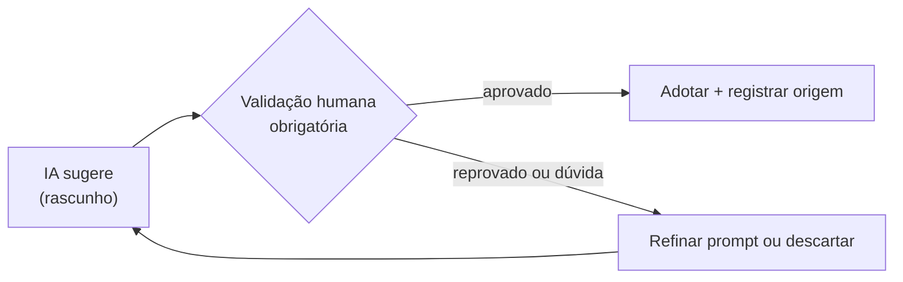

# IA aplicada ao desenvolvimento: playbook responsável

> **Princípio central:** IA = rascunho a validar, nunca decisão pronta.
>
> Material baseado em *Unidade 2 · Aula 5 — IA aplicada à Refatoração, Seleção de Padrões, Revisão de Código e Documentação*, Prof. Nataniel Paiva.

Este projeto é um guia prático para usar IA generativa com responsabilidade em quatro frentes do ciclo de desenvolvimento. Cada sugestão precisa de validação humana contextualizada; decisões arquiteturais, aprovações e merges nunca são delegados à IA.

## Por onde começar

| Conteúdo | O que você encontra |
|---|---|
| [Panorama e limites](docs/01-panorama-e-limites.md) | Benefícios, riscos e princípios de uso |
| [Refatoração](docs/02-ia-na-refatoracao.md) | Smells, testes antes/depois e reversão |
| [Seleção de padrões](docs/03-ia-na-selecao-de-padroes.md) | Observer no Spring e alerta contra over-engineering |
| [Revisão de código](docs/04-ia-na-revisao-de-codigo.md) | IA como primeira triagem e checkpoint humano |
| [Documentação](docs/05-ia-na-documentacao.md) | Javadoc, C4 e limites da documentação gerada |
| [Playbooks](playbooks/) | Passos e checklists humanos por frente |
| [Prompts](prompts/) | Prompts de exemplo com verificações obrigatórias |
| [Templates](templates/) | Registro de IA, PR e ADR |
| [Diagramas](diagramas/) | Fontes Mermaid dos fluxos |
| [Demo Spring](demo/) | Mini-sistema Java 21 com smells legados, Observer e testes |

## Fluxo responsável



## Regras de uso

- Leia o código e o contexto de negócio antes de aceitar uma sugestão.
- Em refatorações, rode a suíte antes e depois de cada passo pequeno; reverta se o comportamento mudar.
- Avalie se o problema é real antes de adotar um padrão; código gerado com facilidade também pode ser complexidade desnecessária.
- Use a IA na revisão como triagem. Uma pessoa com contexto deve revisar e aprovar antes do merge.
- Registre apoio relevante de IA, confira licenças e siga a política da organização.
- Trate diagramas, Javadoc, ADRs e demais textos gerados como rascunhos. Código revela estrutura, não necessariamente intenção arquitetural.

## Demo

Requer JDK 21 e Maven:

```sh
cd demo
mvn test
mvn spring-boot:run
```

Consulte [demo/README.md](demo/README.md) para endpoints, exemplos e explicação das versões legada e orientada a eventos.

## Fonte

Conteúdo elaborado a partir de *Unidade 2 · Aula 5 — IA aplicada à Refatoração, Seleção de Padrões, Revisão de Código e Documentação*, Prof. Nataniel Paiva. O material é educacional; exemplos de ferramentas são genéricos e não afirmam capacidades de produtos específicos.
