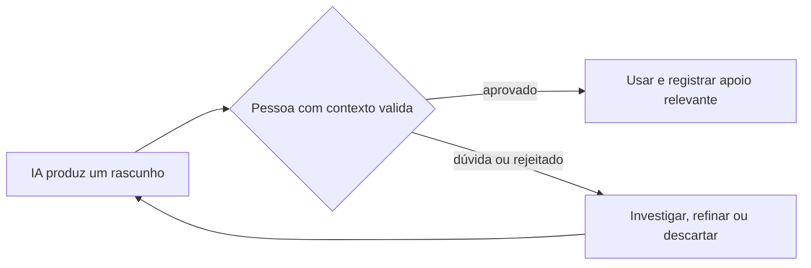

# 1. Panorama e limites

Assistentes de IA podem acelerar a identificação de code smells, a exploração de padrões, a primeira triagem de pull requests e a produção de rascunhos de documentação. Velocidade não é garantia de correção: a saída precisa ser examinada como qualquer contribuição ainda não validada.

## Limites que mudam a decisão

- **Alucinação:** uma sugestão plausível pode estar incorreta, incompleta ou inadequada ao código real.
- **Contexto de negócio incompleto:** o modelo pode desconhecer restrições regulatórias, decisões anteriores, compatibilidade e motivos pelos quais uma solução existe.
- **Vieses e propriedade intelectual:** saídas podem reproduzir padrões enviesados ou conteúdo sujeito a licenças. A pessoa responsável deve seguir as políticas da organização e conferir a procedência quando necessário.
- **Intenção arquitetural:** código e diagramas inferidos mostram estrutura observável, não necessariamente objetivos e trade-offs.

## Princípio operacional

Não mescle, publique ou aprove uma sugestão somente porque foi produzida por IA. A responsabilidade pela decisão permanece com as pessoas.

## Registro mínimo

Para mudanças materiais, anote onde a IA ajudou, o que foi aproveitado, quem verificou e quais evidências sustentam a decisão. O [modelo de registro](../templates/registro-de-apoio-de-ia.md) pode ser copiado para PRs e documentos.
