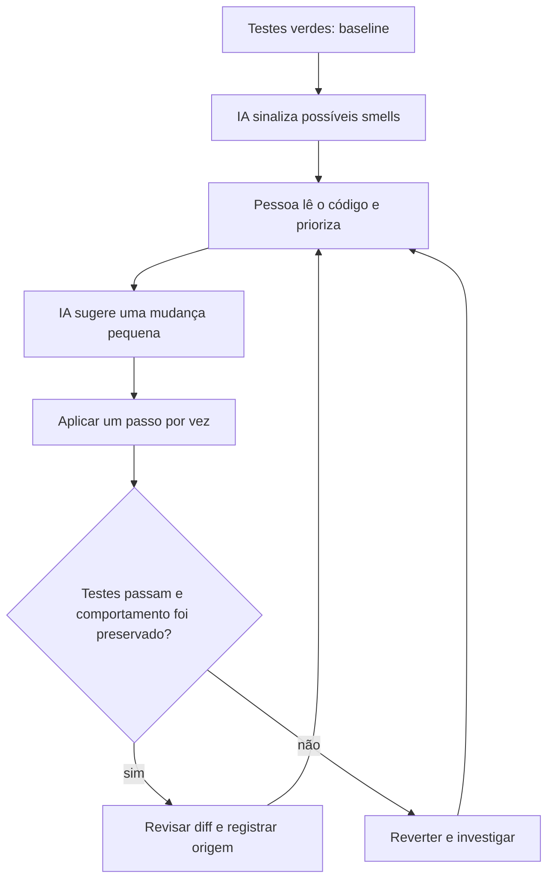

# 2. IA na refatoração

A IA pode apontar métodos longos, classes com responsabilidades misturadas, duplicação e listas longas de parâmetros. Em sistemas legados, isso ajuda a formar uma lista inicial de candidatos; não substitui leitura crítica nem priorização humana.

## Fluxo seguro

O significado de refatorar é melhorar a estrutura interna sem alterar o comportamento observável. Uma suíte verde é uma rede de segurança, mas não prova por si só que todos os comportamentos importantes foram cobertos; complemente-a com revisão e casos de borda.

## Smells no demo

`demo/src/main/java/br/com/aula5/demo/legacy/LegacyOrderService.java` concentra cálculo, regras de cliente, cupom, frete e montagem de resposta em um método com muitos parâmetros. Os testes em `demo/src/test/java/br/com/aula5/demo/legacy/LegacyOrderServiceTest.java` registram cenários de referência.

## Checklist humano

- [ ] Rode a suíte e registre o resultado antes de alterar o código.
- [ ] Confirme que o smell apontado existe e que vale a pena tratá-lo agora.
- [ ] Faça uma mudança pequena, com diff compreensível e sem misturar funcionalidades.
- [ ] Rode os mesmos testes depois da mudança e adicione casos para regras relevantes.
- [ ] Compare resultados observáveis, incluindo limites e erros.
- [ ] Se houver regressão ou dúvida, reverta e investigue; não esconda o teste falho.
- [ ] Revise a solução final e registre a origem de sugestões relevantes.

Veja o [playbook de refatoração](../playbooks/refatoracao.md) e o [prompt de análise](../prompts/refatoracao.md).
