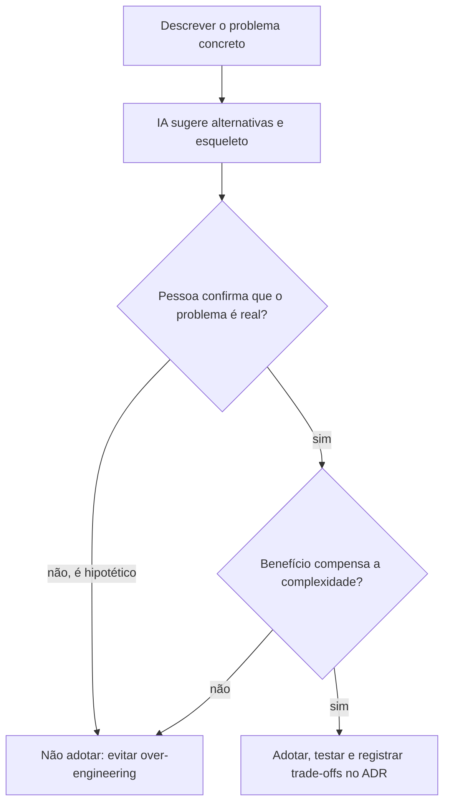

# 3. IA na seleção de padrões

Problema de referência: notificar vários componentes quando o status do pedido muda, sem acoplá-los diretamente. Observer é uma alternativa possível, e o Spring oferece publicação e escuta de eventos com `ApplicationEventPublisher` e `@EventListener`.

No demo, `OrderService` publica `OrderStatusChangedEvent`; `NotificationListener` e `AuditListener` reagem sem que o serviço conheça suas implementações. A entrega síncrona é suficiente para demonstrar o padrão; não representa garantia de processamento durável.

## Decidir antes de implementar

## Contraexemplo: excesso de engenharia

Criar um barramento próprio, fábrica de eventos, registro global, hierarquia de estratégias, configuração dinâmica e abstrações genéricas para dois ouvintes locais pode aumentar o custo de manutenção sem resolver uma necessidade demonstrada. A facilidade de gerar esse código não é evidência de que ele seja necessário.

## Checklist humano

- [ ] Existe uma necessidade atual e verificável de notificar múltiplos consumidores?
- [ ] O acoplamento atual causa um custo ou risco concreto?
- [ ] A solução mais simples atende ao requisito?
- [ ] Foram avaliados sincronismo, falhas, ordenação e necessidade de durabilidade?
- [ ] O teste demonstra o comportamento, sem testar detalhes incidentais?
- [ ] Os trade-offs e a decisão foram registrados, se forem arquiteturalmente relevantes?

Consulte o [playbook de padrões](../playbooks/selecao-de-padroes.md), o [demo Spring](../demo/) e o [template de ADR](../templates/adr-template.md).
