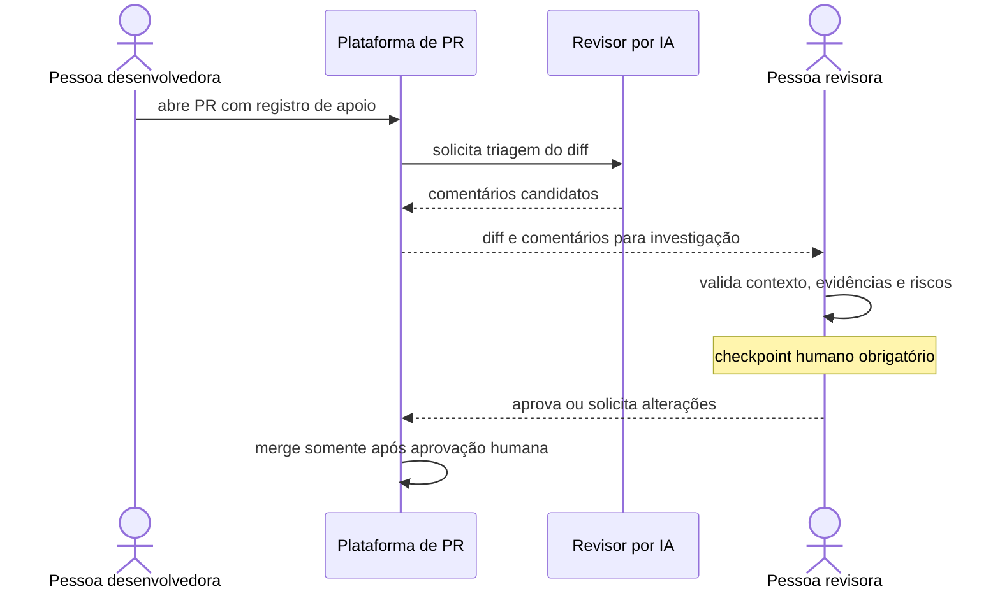

# 4. IA na revisão de código

Uma ferramenta de revisão assistida por IA pode fazer uma primeira triagem de um diff e chamar atenção para possíveis problemas de SOLID, segurança, estilo e testes ausentes. Esses comentários são hipóteses para investigar, não vereditos nem aprovação.

## Exemplos de comentários candidatos

No contexto de `demo/src/main/java/br/com/aula5/demo/legacy/LegacyOrderService.java`:

- **SOLID / responsabilidades:** “Este método calcula desconto, frete, imposto e descrição. Considere separar regras apenas se isso reduzir acoplamento e facilitar testes; preserve o comportamento observado.”
- **Validação / segurança:** “Confirme se `customerType` e `paymentMethod` vêm de entrada externa e onde são validados. O demo não implementa pagamento real; não infira segurança apenas pelo nome do campo.”
- **Testes:** “Há cenários para cupom e cliente recorrente? Inclua limites e combinações relevantes antes de extrair as regras.”

São exemplos de perguntas para revisão, não achados confirmados. O revisor deve verificar o código e o contexto antes de solicitar mudanças.

## Boas práticas

1. **Transparência:** registre quando uma sugestão relevante veio de IA.
2. **Checkpoint humano:** uma pessoa que conhece o contexto revisa e aprova; IA não faz merge nem substitui aprovação.
3. **Vieses e propriedade intelectual:** siga políticas organizacionais e verifique licenças quando aplicável.
4. **Evidência:** peça localização no diff, raciocínio verificável e teste reproduzível; descarte comentários genéricos sem sustentação.

## Checklist humano

- [ ] O PR declara apoio relevante de IA?
- [ ] Cada comentário foi confirmado no código e no contexto?
- [ ] Riscos de segurança têm cenário e evidência, em vez de especulação?
- [ ] Testes cobrem comportamento novo e casos de borda?
- [ ] Uma pessoa autorizada revisou e aprovou antes do merge?

Use o [playbook de revisão](../playbooks/revisao-de-codigo.md) e o [template de PR](../templates/pull-request-template.md).
