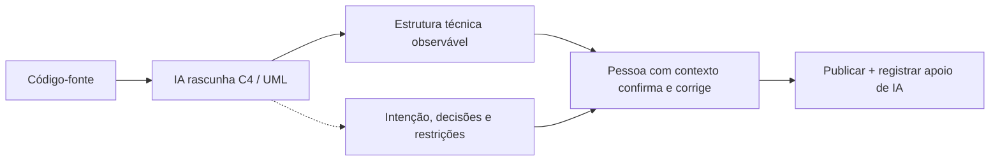

# 5. IA na documentação

IA pode rascunhar Javadoc a partir de assinaturas e corpos, diagramas C4/UML a partir de classes como `@RestController`, `@Service` e `@Repository`, ou um ADR a partir de notas de reunião. Tudo precisa ser verificado por alguém que conheça o sistema.

## Código observado e intenção

Um diagrama inferido pode representar as dependências atuais e ainda omitir por que elas existem, quais limites de negócio se aplicam ou que partes são temporárias. Não transforme inferência em decisão arquitetural documentada sem validação.

## Exemplo de Javadoc: rascunho revisado

No demo, `OrderService.changeStatus` muda o status e publica um evento apenas quando há mudança. A documentação deve dizer isso sem prometer persistência, entrega assíncrona ou garantias não implementadas. Veja a implementação e o comentário em `demo/src/main/java/br/com/aula5/demo/order/OrderService.java`.

## Checklist humano

- [ ] As classes, relações e limites representados conferem com o código atual?
- [ ] O texto distingue fatos implementados de inferências?
- [ ] Decisões e restrições de negócio foram confirmadas por quem conhece sua origem?
- [ ] O documento continua válido após a mudança de código?
- [ ] O apoio de IA e as verificações estão registrados?

Consulte o [playbook de documentação](../playbooks/documentacao.md) e o [prompt de C4/Javadoc](../prompts/documentacao.md).
