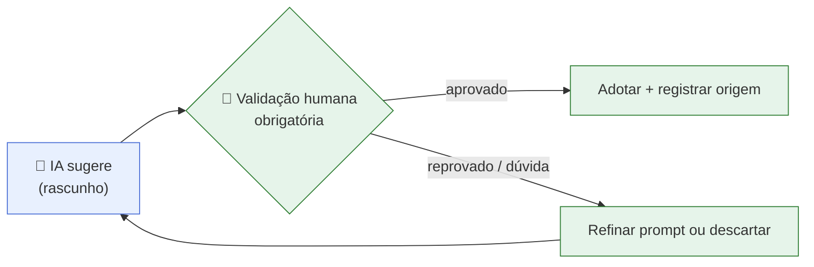
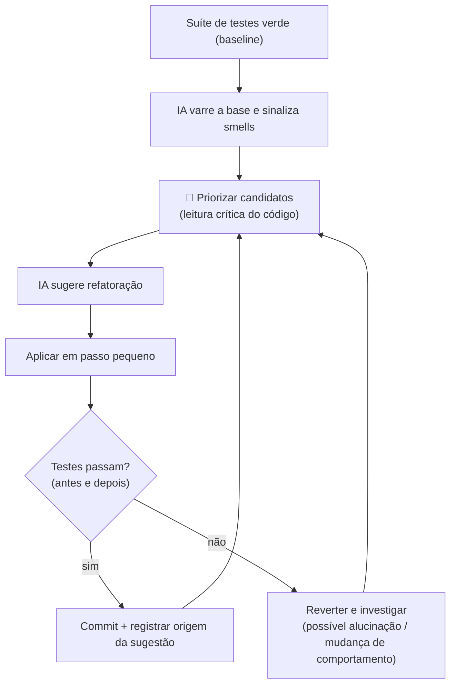
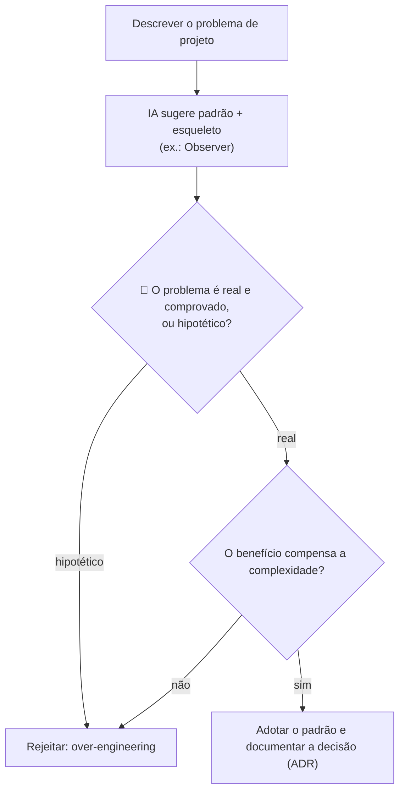
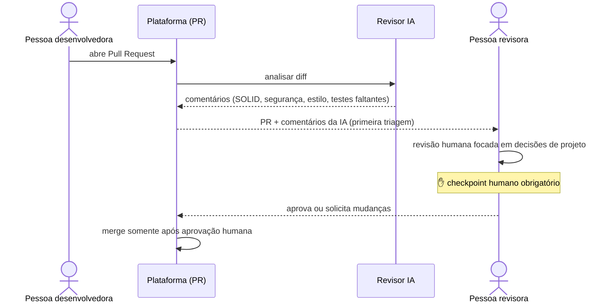
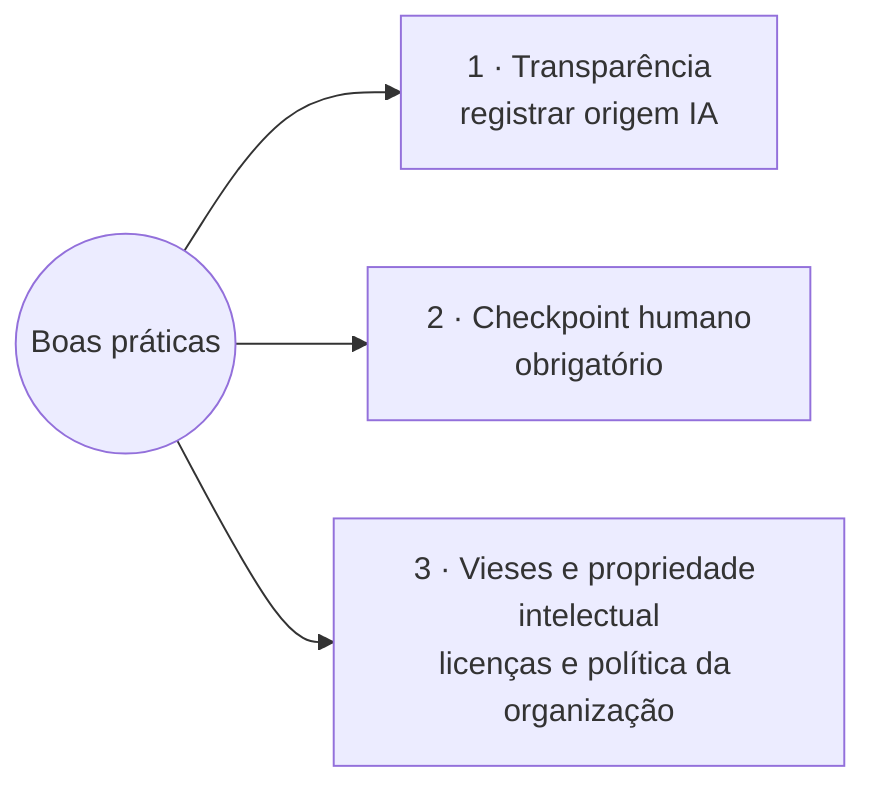
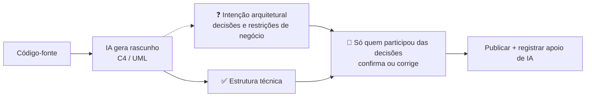
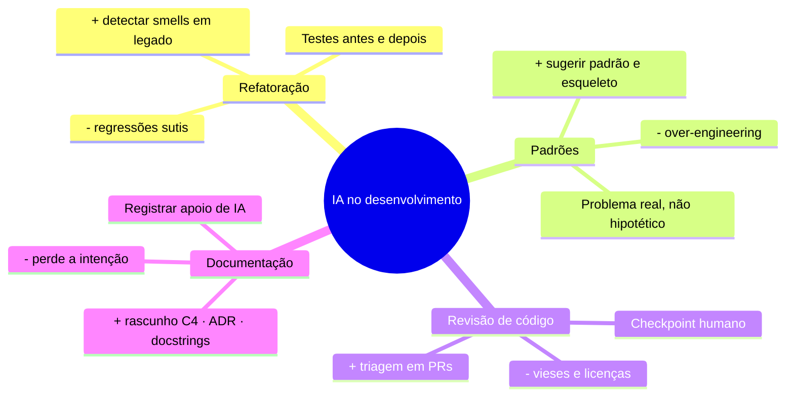
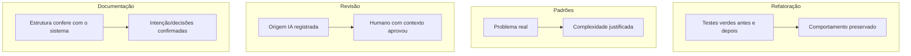

# Unidade 2 · Aula 5 — IA aplicada à Refatoração, Seleção de Padrões, Revisão de Código e Documentação

> **Curso:** Arquitetura de Sistemas e Microsserviços · **Unidade 2 · Aula 5** · Prof. Nataniel Paiva
> **Fonte:** `Aula5_..._IA aplicada à Refatoração, Seleção de Padrões, Revisão de Código e Documentação_unidade02_aula05.pptx` (32 slides)

Este README é um **briefing para outra IA** criar um projeto visual sobre o **uso responsável de IA generativa** em quatro frentes do ciclo de desenvolvimento. Conteúdo extraído dos slides; diagramas Mermaid são **exemplos prontos** para o GitHub.

---

## 1. Objetivo do projeto a ser gerado

Um **guia prático e visual** (playbook) com: fluxos de uso de IA em refatoração, seleção de padrões, revisão de código e documentação; **checklists de verificação humana**; modelos de registro de transparência; e exemplos de prompts. Pode incluir um **repositório-demo** com PR, testes e documentação rastreando a origem das sugestões de IA.

**Idioma:** PT-BR. **Tom:** pragmático, com o princípio central **"IA = rascunho a validar, nunca decisão pronta"**.

### 1.1 Stack de código (obrigatória)

> **Todo código do projeto DEVE ser em Java com Spring.** Não gerar exemplos em outras linguagens.

- **Java 21 (LTS)** + **Spring Boot 3.x** · **Maven** · **JUnit 5** + Mockito.
- O **repositório-demo** (`demo/`) é um mini-sistema **legado em Spring Boot** com smells propositais (método longo, classe com responsabilidades misturadas, condicional por tipo, lista longa de parâmetros) e **testes que passam**; as refatorações simuladas "sugeridas por IA" devem manter os testes verdes **antes e depois**.
- **Seleção de padrões:** o problema dos slides ("notificar vários componentes quando o status do pedido muda, sem acoplar") resolvido com **Observer** via `ApplicationEventPublisher`/`@EventListener`; mostrar também a versão "excessiva" (over-engineering) como contraexemplo.
- **Revisão de código:** `pull-request-template.md` com o campo de **apoio de IA**; exemplos de comentários de revisão sobre SOLID/segurança/testes faltantes aplicados ao código Spring do demo.
- **Documentação:** exemplo de **docstrings (Javadoc)** geradas como rascunho e revisadas; rascunho de C4 a partir das classes `@RestController`/`@Service`/`@Repository`.
- Nomes de ferramentas de IA e de qualquer plugin/CI são *exemplo adicional* (usar termos genéricos).

## 2. Resumo do conteúdo (fonte de verdade)

### 2.1 Panorama e limites (1)
- Em 2026 assistentes no editor, revisão automatizada e LLMs conversacionais são parte comum do fluxo; sugerem refatorações, identificam padrões, comentam PRs e geram rascunhos de documentação **muito mais rápido** que uma pessoa.
- **Limites:** *alucinação* (sugestões plausíveis mas incorretas ou inadequadas ao contexto); **sem acesso ao contexto de negócio completo** (por que uma decisão foi tomada, restrições regulatórias) → limitada para avaliar tradeoffs. **Toda sugestão é rascunho a validar.**

### 2.2 IA na refatoração (2)
- **Identificação de smells:** varre a base e sinaliza método longo, classe com responsabilidades misturadas, duplicação, lista longa de parâmetros — útil para **assumir sistema legado** (ponto de partida para priorizar; **não substitui a leitura crítica**).
- **Riscos:** refatoração que parece correta mas **altera sutilmente o comportamento** (viola a definição de refatoração). Exige **suíte de testes robusta**: rodar os testes **antes e depois** de cada mudança, como se fosse manual. Refatorar sem essa rede de segurança é arriscado, seja a origem humana ou IA.

### 2.3 IA na seleção de padrões (3)
- Dado um problema ("notificar vários componentes quando o status do pedido muda, sem acoplar") a IA pode sugerir o padrão (**Observer**) e gerar um esqueleto. Acelera a exploração de alternativas, sobretudo para quem está conhecendo o catálogo GoF.
- **Validação humana:** conferir se o problema realmente exige a flexibilidade; risco de **over-engineering amplificado** pela facilidade de a IA gerar código para qualquer padrão. Avaliar se resolve um problema **real e comprovado, não hipotético** — responsabilidade humana.

### 2.4 IA na revisão de código (4)
- Ferramentas integradas à plataforma analisam o **pull request** e comentam: violações SOLID, padrões aplicáveis, riscos de segurança, inconsistências de estilo, testes faltantes. Aparecem **antes ou em paralelo** à revisão humana → **primeira triagem**, para a pessoa revisora focar em decisões de projeto sutis.
- **Boas práticas (3):**
  1. **Transparência:** registrar no fluxo de revisão quando uma sugestão relevante veio de IA (rastrear procedência).
  2. **Checkpoint humano obrigatório:** nada de IA (refatoração ou aprovação de PR) é mesclado sem revisão de quem conhece o contexto, especialmente em mudanças arquiteturalmente significativas.
  3. **Vieses e propriedade intelectual:** treinados em código público, podem reproduzir trechos sob licenças específicas → seguir as políticas de IA da organização.

### 2.5 IA na documentação de arquitetura (5)
- Acelera: rascunho de **C4/UML a partir do código**, rascunho de **ADR** a partir de descrição informal de reunião, **docstrings** a partir da assinatura/corpo. Reduz a resistência crônica a manter documentação atualizada.
- **Uso responsável:** sempre rascunho a verificar por quem conhece o sistema; C4 gerado do código captura a **estrutura técnica**, não necessariamente as **decisões e restrições de negócio** (a *intenção arquitetural*); **registrar quando houve apoio relevante de IA** → rastreabilidade, fechando o ciclo de uso crítico e responsável (decisão, implementação e documentação).

---

## 3. Exemplos Mermaid (renderizam no GitHub)

### 3.1 Princípio central: IA acelera, humano decide



### 3.2 Refatoração assistida por IA (testes antes e depois)



### 3.3 Seleção de padrão com IA



### 3.4 Revisão de código assistida por IA com checkpoint humano (Figura do slide 21)



### 3.5 Boas práticas de revisão com IA



### 3.6 Documentação com IA: o que ela captura × o que só humanos confirmam



### 3.7 Quatro frentes de uso, benefícios e riscos



### 3.8 Modelo de registro de transparência (copiar para o PR / documento)

````markdown
## Apoio de IA nesta mudança
- **Ferramenta:** (nome/versão)
- **Onde ajudou:** refatoração | sugestão de padrão | revisão | documentação
- **Sugestão relevante:** (resumo)
- **Verificação humana feita por:** (pessoa) em (data)
- **Evidências:** testes antes/depois ✔ · conferência de licença ✔ · análise de tradeoffs ✔
- **Decisão arquitetural envolvida?** não | sim → ADR-xx
````

### 3.9 Checklist de verificação humana (por frente)



---

## 4. Estrutura sugerida do projeto a gerar

```
unidade2-aula5-projeto/
├── README.md                        # princípio "IA = rascunho" + índice
├── docs/
│   ├── 01-panorama-e-limites.md
│   ├── 02-ia-na-refatoracao.md
│   ├── 03-ia-na-selecao-de-padroes.md
│   ├── 04-ia-na-revisao-de-codigo.md
│   └── 05-ia-na-documentacao.md
├── playbooks/                       # passo a passo + checklist de cada frente
├── prompts/                         # exemplos de prompts por frente (com o que verificar)
├── templates/
│   ├── registro-de-apoio-de-ia.md
│   ├── pull-request-template.md     # com campo de transparência
│   └── adr-template.md
├── demo/                            # (opcional) código legado + testes + PR simulado
└── diagramas/                       # .mmd fonte
```

**Prompts de exemplo sugeridos (*exemplo adicional*):** "liste code smells deste módulo e justifique"; "sugira padrões para: *notificar vários componentes quando o status do pedido muda sem acoplá-los*, com prós, contras e risco de over-engineering"; "rascunhe um ADR a partir desta ata" — **cada um acompanhado da lista do que o humano precisa verificar**.

## 5. Regras para a IA que for gerar o projeto

1. **Em todo fluxo, o checkpoint humano precisa estar visível** (nó/nota destacada); nunca represente a IA aprovando ou mesclando sozinha.
2. **Refatoração sempre com testes antes e depois**; incluir o caminho de reversão.
3. **Transparência:** todo exemplo de PR/documento traz o campo de registro de apoio de IA.
4. Sinalizar riscos nomeados nos slides: **alucinação, vieses, propriedade intelectual, over-engineering, perda da intenção arquitetural**.
5. **Mermaid:** `flowchart`, `sequenceDiagram`, `mindmap`; testar renderização no GitHub.
6. Não afirmar capacidades de ferramentas específicas; usar termos genéricos ("assistente de IA", "revisor por IA") e marcar nomes de ferramentas como *exemplo adicional*.
7. Citar: *Unidade 2 · Aula 5 — Prof. Nataniel Paiva*.

## 6. Checklist de aceitação

- [ ] Fluxos das 4 frentes (refatoração, padrões, revisão, documentação) com checkpoint humano
- [ ] Refatoração com testes antes/depois e reversão
- [ ] Sequência do PR com IA como primeira triagem
- [ ] Modelo de registro de transparência + template de PR
- [ ] Lista de riscos (alucinação, vieses, PI, over-engineering) e como mitigar
- [ ] Todos os diagramas renderizam no GitHub
